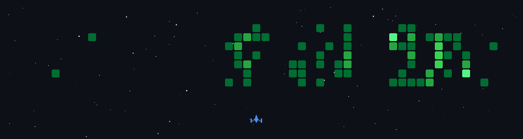

<!-- ═══════════════════════════════════════════════════════════════════
     Profile README v3 · GALAXY · nakshatrameena6-cell
     Custom animated SVGs live in ./assets (header, divider, tech-orbit, footer).
     ./assets/space-shooter.gif is generated by .github/workflows/space-shooter.yml
     Palette: #0B0720 void · #7C3AED nebula · #C084FC violet · #F472B6 pink · #F5C542 star · #5EEAD4 aqua
     ═══════════════════════════════════════════════════════════════════ -->

  

  

  
  
  

## 🌌 Mission Briefing

I'm a Computer Science undergraduate who turns repetitive, real-world problems — grading papers, taking attendance, reading scanned text — into small working products, end to end: **database → API → UI**.

- 🔭 **Currently building** GradeMIND — an AI grading pipeline that OCRs handwritten answer sheets and evaluates them with or without an answer key
- 🌱 **Learning** to build systems that hold up in production — auth, role guards, migrations, CI — not just demos
- 🎯 **Interested in** the intersection of OCR, LLMs, and everyday classroom tooling
- 🛠️ **Shipping fast** with AI-assisted workflows (Claude, Copilot) — several repos carry `CLAUDE.md` / `AGENTS.md` files that document the process, not just the output
- 💬 **Ask me about** FastAPI + Next.js + Supabase stacks

## 🪐 Tech Constellation

  

## 🚀 Missions

| | Mission | What it does | Stack |
|:-:|---|---|---|
| 🪐 | [**GradeMIND**](https://github.com/nakshatrameena6-cell/GradeMIND) | Grades handwritten exam sheets: upload a scan → OCR → per-question score, concept coverage, feedback and a PDF report. An autonomous mode works with **no answer key and no API key**. JWT auth with refresh rotation, role guards, audit log, CI.  Co-built with [@bsrikumar855-dot](https://github.com/bsrikumar855-dot) | `FastAPI` `Next.js` `PostgreSQL` `Docker` `TrOCR` |
| 🛰️ | [**SecureX**](https://github.com/nakshatrameena6-cell/Exam-invigilation) | AI exam proctoring: flags absent or multiple faces, phones and devices, suspicious movement; live dashboard and a timestamped violation report with evidence snapshots. Assists invigilators, doesn't replace them. | `React` `TypeScript` `FastAPI` `YOLO` `OpenCV` |
| 📡 | [**truth-frame**](https://github.com/nakshatrameena6-cell/truth-frame) | Audio scoring API for a synthetic-speech detector. **Milestone 1:** API contract, typed errors and docs are done; scoring is a deterministic stub until real inference lands. | `Python` `FastAPI` `Docker` |
| 🌠 | [**Attendance Tracker**](https://github.com/nakshatrameena6-cell/attendance) | Live dashboard, period-wise marking and absentee history on Supabase / PostgreSQL. | `JavaScript` `Supabase` |
| 🔭 | [**OCR Scanner**](https://github.com/nakshatrameena6-cell/OCR---Scanner) | Drag-and-drop image → Tesseract.js text → Claude API summary at adjustable length. | `Node.js` `Express` `Claude API` |
| ☄️ | [**GraphX**](https://github.com/nakshatrameena6-cell/GraphX) · [live ↗](https://graph-x-lovat.vercel.app) | Interactive graph plotter and equation solver. | `Next.js` `TypeScript` |

Also: [Period-wise Attendance](https://github.com/nakshatrameena6-cell/class-attendance) · [N Sparkle ToDo](https://github.com/nakshatrameena6-cell/ToDo-FET) · [all repositories](https://github.com/nakshatrameena6-cell?tab=repositories)

## 👾 Defending the Contribution Galaxy

  

A ship clears my real contribution graph, updated daily.

## 📊 Telemetry

  
  

  

  

## 📡 Open a Channel

  
  <!-- Add when ready (replace the handle/address, then delete the comment markers): 
  
    
  -->

